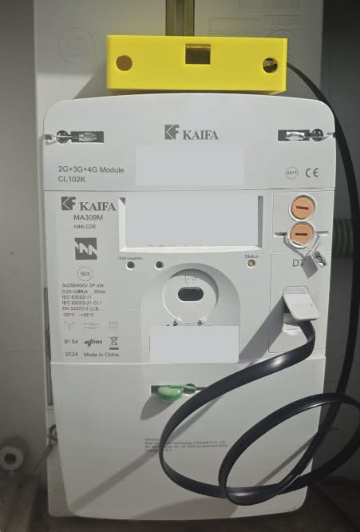
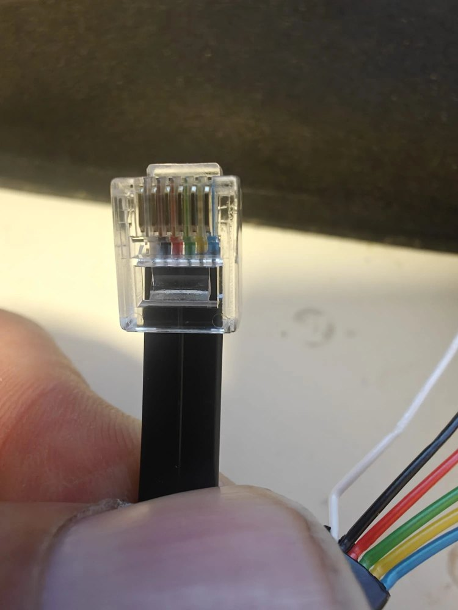
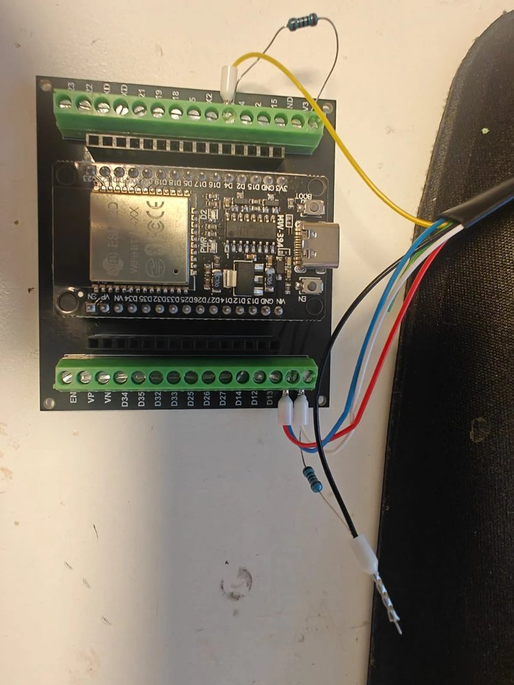
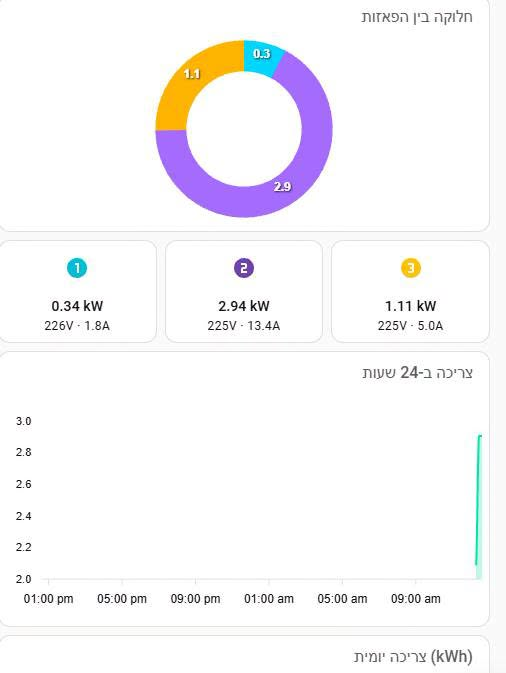
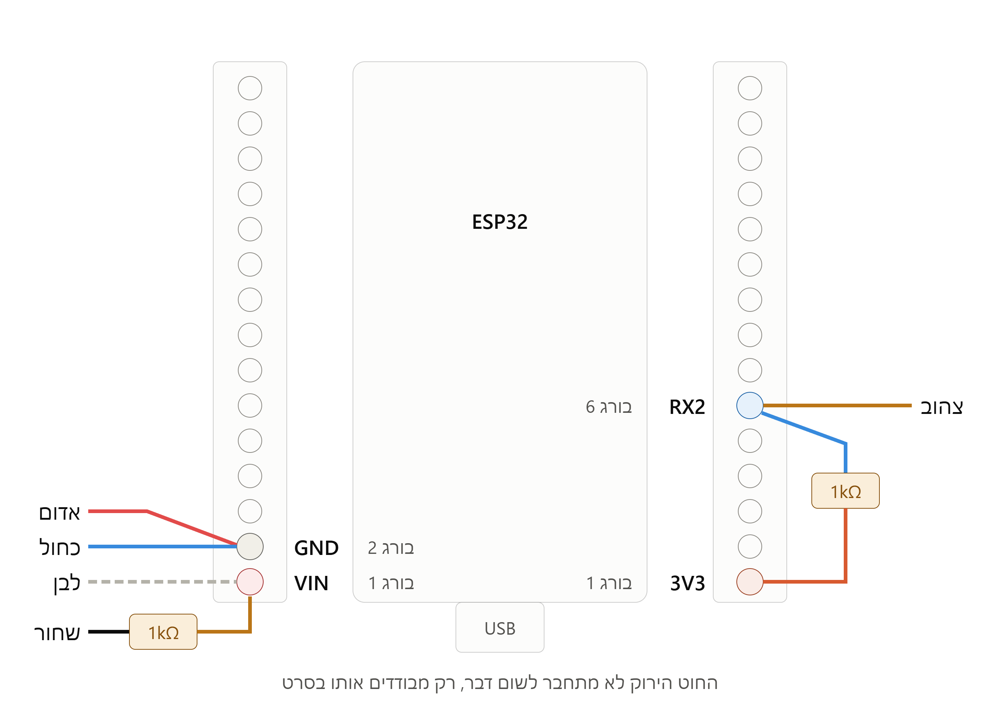
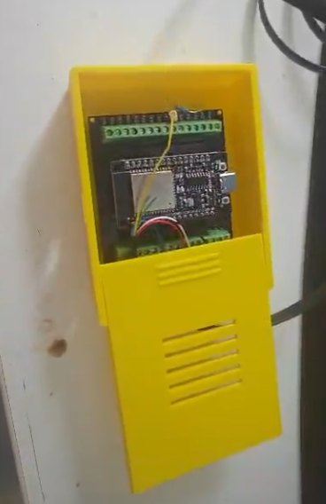

# ⚡ קורא P1 למונה חכם תלת-פאזי של חברת החשמל

קריאת נתונים ממונה Kaifa תלת-פאזי ישראלי דרך יציאת ה-P1, עם ESP32 ו-ESPHome, והצגה ב-Home Assistant: צריכה לפי פאזה, עלות בשקלים, צפי חודשי, השוואה לאתמול ושיא יומי.

*Read an Israeli IEC Kaifa three-phase smart meter through its P1 port with an ESP32 and ESPHome, and show live power, cost and forecasts in Home Assistant.*

מבוסס על הפרויקט המצוין [klimofey/iec-p1-esphome](https://github.com/klimofey/iec-p1-esphome) של Timofey Klimov.

  

<b>מותקן על מונה Kaifa MA309M, בתוך קופסה מודפסת בתלת-ממד</b>

## הפרויקט בתמונות

<table>
  <tr>
    <td align="center" width="33%"> <b>ESP32 על לוח מהדקים</b></td>
    <td align="center" width="33%"> <b>תקע RJ12 עם 6 גידים</b></td>
    <td align="center" width="33%"> <b>אחרי החיווט</b></td>
  </tr>
</table>

  

<b>נתונים חיים ב-Home Assistant: חלוקה בין הפאזות, הספק, מתח, זרם וגרף צריכה</b>

## במה זה שונה מהפרויקט המקורי

| | הפרויקט המקורי | הפרויקט הזה |
|---|---|---|
| **מונה** | Kaifa MA110M, חד-פאזי | Kaifa MA309M, תלת-פאזי |
| **לוח** | Wemos D1 mini | ESP32 בעל 30 פינים על לוח מהדקים |
| **פריימוורק** | Arduino | ESP-IDF |
| **קריאת הנתונים** | רכיב `dsmr` | קוד ייעודי עם בדיקת CRC |
| **פאזות** | L1 | L1, L2, L3 |
| **Home Assistant** | סנסורים | סנסורים, עלות, צפי ודשבורד מוכן |

**למה לא `dsmr`?** ב-ESPHome 2025.11 הרכיב דורש Arduino, ואין בו מוני אנרגיה ישראליים `1.8.11`–`1.8.13` או `energy_delivered_tariff3`. לכן הקוד כאן קורא את הנתונים ישירות, ומפרסם דיווח רק אם ה-CRC שלו תקין.

## מה נדרש

| רכיב | פרטים | קישור |
|---|---|---|
| ESP32 + לוח מהדקים | ESP32 בעל 30 פינים (נבדק עם ESP32-32D) | [לרכישה](https://s.click.aliexpress.com/e/_c3dcaJht) |
| כבל RJ12 | 6 גידים (6P6C), צריך כבל עם כל ששת המגעים. כבל רשת רגיל (RJ45) לא מתאים | [לרכישה](https://s.click.aliexpress.com/e/_c38fIZmx) |
| 2 נגדים | 1kΩ בלבד | [לרכישה](https://s.click.aliexpress.com/e/_c3BhyhVt) |
| קופסה (לא חובה) | להדפסה בתלת-ממד | [קובץ ב-MakerWorld](https://makerworld.com/en/models/3523403-breakout-board-for-esp#profileId-4027704) |

בנוסף צריך:

* מולטימטר
* Home Assistant עם ESPHome
* מ-HACS: `Mushroom`, `ApexCharts Card` ו-`card-mod`

## חיווט

| פין ב-RJ12 | תפקיד | מתחבר אל | צבע בכבל שלי |
|---|---|---|---|
| 1 | +5V | `VIN` | לבן |
| 2 | Request | דרך נגד 1kΩ אל +5V | שחור |
| 3 | Data GND | `GND` | אדום |
| 4 | לא בשימוש | לבודד, לא לחבר | ירוק |
| 5 | Data | `GPIO16` (RX2) | צהוב |
| 6 | Power GND | `GND` | כחול |

בנוסף, מחברים נגד 1kΩ בין `3V3` ל-`GPIO16`.

> [!WARNING]
> **צבעי החוטים תקפים לכבל שלי בלבד.** בדוק את שלך: מחזיקים את התקע עם הקצה למעלה והמגעים המוזהבים מולך, ופין 1 משמאל. בכבל שלי **האדום הוא לא 5V**.

> [!CAUTION]
> * לפני חיבור ה-ESP32, חבר את התקע למונה בלי ה-ESP32 ומדוד DC בין `VIN` ל-`GND`. צריך לראות בערך **5V+**. אם מופיע **5V-**, הכיוון הפוך.
> * אל תחבר USB ואת המונה בו-זמנית.
> * הצד של ה-Request לעולם לא מתחבר לפין של ה-ESP32, כי 5V יגיעו אליו.
> * עובדים רק מול יציאת ה-P1. לא נוגעים בצד החשמלי של המונה.

## התקנה

### 1. ESP32

1. העתק את [`esphome/secrets.example.yaml`](esphome/secrets.example.yaml) ל-`secrets.yaml` ומלא את הפרטים שלך.
2. העלה את [`esphome/electricity-meter.yaml`](esphome/electricity-meter.yaml) דרך USB, **כשהמונה מנותק**.
3. נתק את ה-USB, חבר את המעגל למונה, ובדוק ב-Logs שמופיעות שורות `Sending state`.
4. הוסף את המכשיר ב-**Settings > Devices & services**.

### 2. Home Assistant

1. הוסף את [`homeassistant/configuration.yaml`](homeassistant/configuration.yaml) לקובץ `configuration.yaml` שלך. אם כבר יש בקובץ `sensor:` או `template:`, מזג את הקטעים במקום לשכפל אותם.
2. לחץ **Check configuration**, ואז בצע **Restart** מלא.
3. עדכן את המחיר שלך לקוט"ש ב-`price_with_vat`, ואת ההנחה ב-`discount_percent`.

### 3. דשבורד

הדבק את [`homeassistant/dashboard.yaml`](homeassistant/dashboard.yaml) בכרטיס **Manual**. כוון את `max` בשעון העומס: `17` ל-3×25A, או `27` ל-3×40A.

## 📦 קופסה להדפסה בתלת-ממד

  

תכננתי קופסת קיר ללוח, עם מכסה נשלף וחריצי אוורור. קובץ ההדפסה זמין ב-[MakerWorld](https://makerworld.com/en/models/3523372-esp-breakout-board-box#profileId-4027663).

## מה מקבלים

* **מצב הבית עכשיו** וכמה היום יעלה בקצב הנוכחי
* **השוואה לאתמול באותה שעה**, באחוזים
* **שיא יומי** והשעה שבה הוא קרה
* **עלות** של היום והחודש, וצפי לסוף החודש
* **עלות הצריכה כשכמעט הכול כבוי**, כדי לאתר מכשירים שדולקים כל הזמן
* הספק, מתח וזרם בכל פאזה, וגרפים של 24 שעות ו-14 ימים

## קודי OBIS שנמצאו במונה

| קוד | משמעות |
|---|---|
| `1-0:1.8.11` / `.12` / `.13` | אנרגיה נצרכת, T1 / T2 / T3 |
| `1-0:2.8.11` / `.12` / `.13` | אנרגיה מוחזרת לרשת, T1 / T2 / T3 |
| `0-0:96.14.1` | תעריף פעיל |
| `1-0:1.7.0` / `1-0:2.7.0` | הספק נצרך / מוחזר |
| `1-0:21.7.0` / `41.7.0` / `61.7.0` | הספק נצרך לפי פאזה |
| `1-0:32.7.0` / `52.7.0` / `72.7.0` | מתח לפי פאזה |
| `1-0:31.7.0` / `51.7.0` / `71.7.0` | זרם לפי פאזה |

## הגבלות

* העלות מחושבת לפי מחיר קבוע, ולא כוללת תשלום קבוע אלא אם הוספת אותו ב-`fixed_charge`.
* הנחה לפי שעות עדיין לא נתמכת.
* הצפי הוא לפי חודש קלנדרי, ולא לפי תקופת החשבון.
* ההשוואה לאתמול מתחילה לעבוד רק אחרי יממה מלאה של נתונים.
* הפרויקט נבדק על מונה אחד בלבד, וקודים עשויים להיות שונים במונים אחרים.

## תקלות נפוצות

| תקלה | מה לבדוק |
|---|---|
| המכשיר Offline אחרי עדכון | אם פרטי ה-Wi-Fi הוזנו רק דרך הדף `192.168.4.1`, הם עלולים להימחק בעדכון. שמור אותם ב-`secrets.yaml`. |
| `bad CRC` חוזר | החיווט, הנגדים וה-`inverted: true`. |
| כרטיסים מציגים 0 או `Entity not found` | שהמכשיר נוסף ל-Home Assistant, ושבוצע Restart מלא אחרי עריכת `configuration.yaml`. |

## קרדיט ורישיון

מבוסס על [iec-p1-esphome](https://github.com/klimofey/iec-p1-esphome) מאת Timofey Klimov, ברישיון MIT.
הפרויקט הזה מופץ גם הוא ברישיון MIT. ראה [`LICENSE`](LICENSE).

**לשימוש על אחריותך בלבד.** אין קשר לחברת החשמל או ל-Kaifa.
