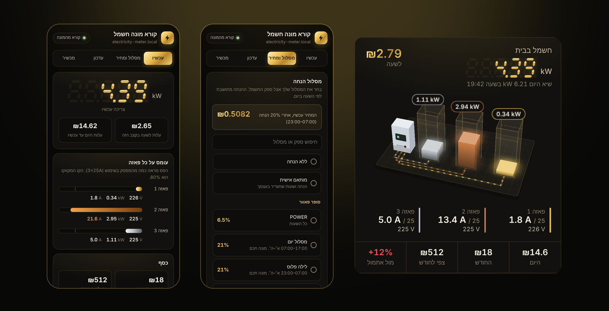
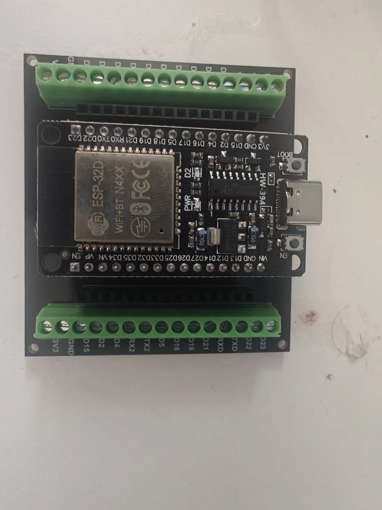
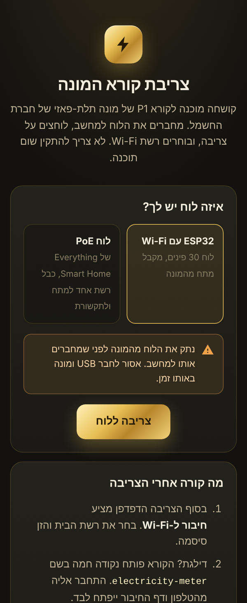
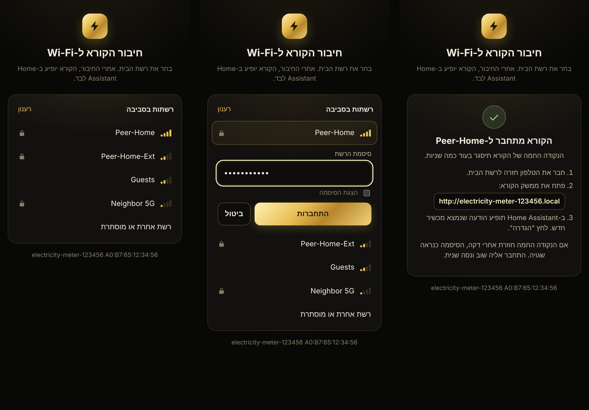
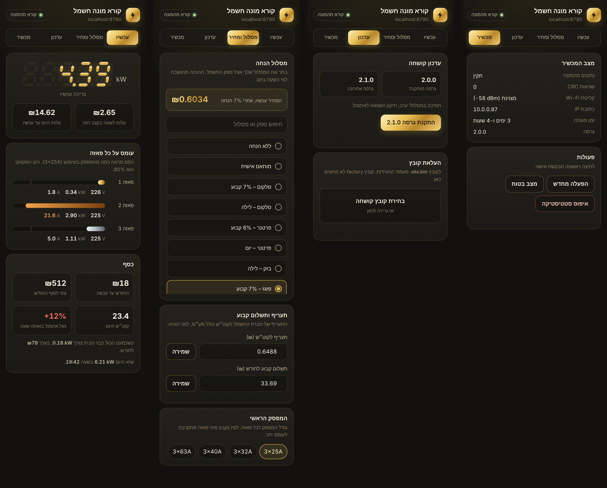
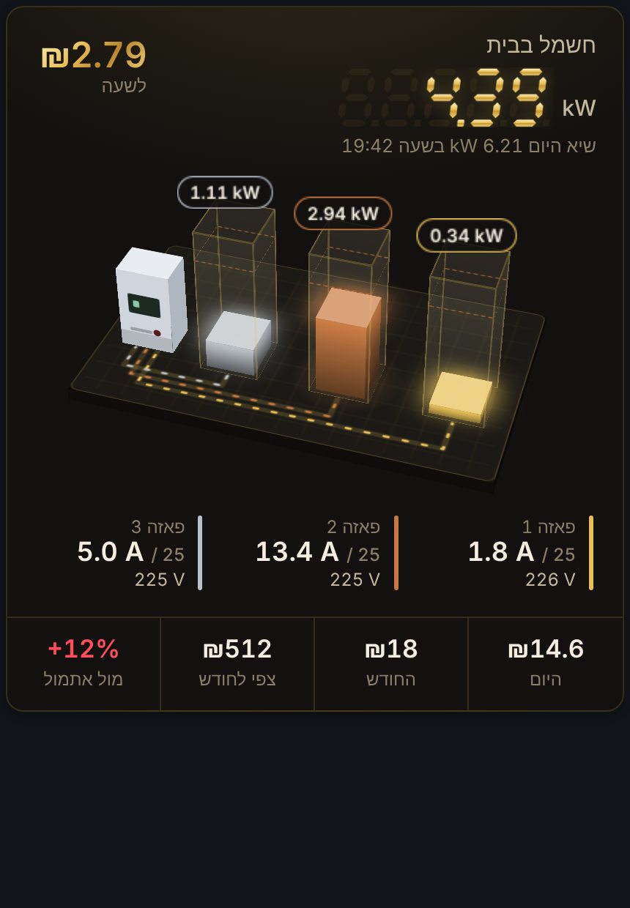

<div dir="rtl" align="right">

<h1 align="center">⚡ קורא מונה חשמל תלת-פאזי</h1>

<p align="center">
קורא את מונה ה-Kaifa של חברת החשמל דרך יציאת ה-P1, ומציג צריכה ועלות בשקלים.<br>
צורבים מהדפדפן, מגדירים בממשק זהב במכשיר, ו-Home Assistant מזהה אותו לבד.
</p>

<p align="center" dir="ltr">
  <a href="https://github.com/moshiko2312/iec-p1-esphome-3phase/releases/latest"></a>
  <a href="https://github.com/moshiko2312/iec-p1-esphome-3phase/actions/workflows/build.yml"></a>
  
  
  <a href="LICENSE"></a>
</p>

<p align="center">
  <a href="https://moshiko2312.github.io/iec-p1-esphome-3phase/"><b>צריבה מהדפדפן</b></a>
  &nbsp;|&nbsp;
  <a href="https://github.com/moshiko2312/iec-p1-esphome-3phase/releases/latest"><b>הורדת הקושחה</b></a>
  &nbsp;|&nbsp;
  <a href="#התקנה-בחמישה-שלבים"><b>מדריך התקנה</b></a>
</p>

<p align="center"></p>

<p align="center" dir="ltr"><i>Prebuilt ESPHome firmware for reading an Israeli IEC Kaifa three-phase smart meter over P1, with an on-device cost engine for Israeli supplier plans, a built-in web UI and automatic Home Assistant discovery.</i></p>

## מה זה עושה

| תכונה | מה זה אומר |
|---|---|
| **צריבה בלי ESPHome** | קושחה מוכנה שצורבים מהדפדפן, ועובדת גם עם Home Assistant Container |
| **חיבור פשוט ל-Wi-Fi** | מסך חיבור מיד אחרי הצריבה, או דף זהב מהנקודה החמה של המכשיר |
| **ממשק זהב במכשיר** | נתונים חיים, בחירת מסלול ספק, תעריף, גודל מפסק ועדכון קושחה |
| **עלות בשקלים** | המכשיר עצמו מחשב עלות לפי המחיר בשעת הצריכה, צפי לסוף החודש, השוואה לאתמול, שיא יומי וצריכה כשהכול כבוי |
| **26 מסלולים** | סופר פאוור, סלקום, בזק, פרטנר, הוט, אמישראגז, פזגז, תעו"ז של חברת החשמל, ומסלול מותאם אישית |
| **Home Assistant** | מזהה את המכשיר לבד, וכל הנתונים זמינים בלי שורת YAML |
| **עדכונים** | בלחיצה מ-Home Assistant, בהעלאת קובץ בממשק, או מ-ESPHome |
| **שני לוחות** | ESP32 DevKit עם Wi-Fi, או EST-PoE-32 עם רשת קווית |
| **כרטיס תלת-ממד** | כרטיס ל-Home Assistant שמראה את העומס על כל פאזה ביחס למפסק |

## מה צריך

| רכיב | פרטים | קישור |
|---|---|---|
| **לוח, אפשרות א'** | ESP32 בעל 30 פינים על לוח מהדקים (נבדק עם ESP32-32D). מקבל מתח מהמונה ומתחבר ב-Wi-Fi | [לרכישה](https://s.click.aliexpress.com/e/_c3dcaJht) |
| **לוח, אפשרות ב'** | EST-PoE-32 של Everything Smart Technology. רשת קווית, מתח מ-PoE, מ-USB-C או מ-9–28V | [לרכישה](https://shop.everythingsmart.io/products/est-poe-32-esp32-poe-development-board) |
| **כבל RJ12** | 6 גידים (6P6C) עם כל ששת המגעים. כבל רשת רגיל (RJ45) לא מתאים | [לרכישה](https://s.click.aliexpress.com/e/_c38fIZmx) |
| **2 נגדים** | 1kΩ | [לרכישה](https://s.click.aliexpress.com/e/_c3BhyhVt) |
| **קופסה** (לא חובה) | להדפסה בתלת-ממד, ללוח ה-DevKit | [MakerWorld](https://makerworld.com/en/models/3523403-breakout-board-for-esp#profileId-4027704) |

בנוסף: מולטימטר, ומחשב עם Chrome או Edge לצריבה.

## התקנה בחמישה שלבים

| שלב | מה עושים | זמן |
|:---:|---|:---:|
| 1 | [חיווט הלוח לכבל](#שלב-1-חיווט) | 15 דק' |
| 2 | [צריבת הקושחה מהדפדפן](#שלב-2-צריבה) | 3 דק' |
| 3 | [חיבור לרשת](#שלב-3-חיבור-לרשת) | 2 דק' |
| 4 | [בחירת מסלול ותעריף בממשק](#שלב-4-הגדרות-בממשק-הזהב) | 2 דק' |
| 5 | [הוספה ל-Home Assistant](#שלב-5-home-assistant) | 1 דק' |

---

### שלב 1: חיווט

> ⚠️ **זהירות**
>
> - עובדים רק מול יציאת ה-P1. לא נוגעים בצד החשמלי של המונה.
> - לפני חיבור הלוח, מחברים את התקע למונה **בלי הלוח**, ומודדים DC בין פין 1 לפין 6. צריך לראות בערך **5V+**. אם מופיע **5V-**, הכיוון הפוך.
> - חוט ה-Request מתחבר רק דרך הנגד אל ה-+5V, ולעולם לא לפין GPIO.

**איך סופרים פינים:** מחזיקים את התקע עם הקליפס למעלה והמגעים המוזהבים מולך. פין 1 הוא השמאלי. צבעי החוטים משתנים מכבל לכבל, לכן תמיד בודקים לפי מיקום ולא לפי צבע.

#### אפשרות א': ESP32 DevKit (Wi-Fi)

<p align="center"></p>

| פין ב-RJ12 | תפקיד | מתחבר אל |
|:---:|---|---|
| 1 | +5V מהמונה | `VIN` |
| 2 | Request | דרך נגד 1kΩ אל `VIN` |
| 3 | Data GND | `GND` |
| 4 | לא בשימוש | לבודד |
| 5 | Data | `GPIO16` (RX2) |
| 6 | Power GND | `GND` |

ועוד נגד 1kΩ בין `3V3` ל-`GPIO16`.

> ⚠️ **שים לב**
>
> בלוח הזה לא מחברים USB ומונה באותו זמן.

#### אפשרות ב': EST-PoE-32 (רשת קווית)

הלוח מקבל מתח מה-PoE, **לא מהמונה**.

| פין ב-RJ12 | תפקיד | מתחבר אל |
|:---:|---|---|
| 1 | +5V מהמונה | **לא ללוח.** רק לרגל אחת של נגד 1kΩ |
| 2 | Request | לרגל השנייה של אותו נגד |
| 3 | Data GND | `GND` |
| 4 | לא בשימוש | לבודד |
| 5 | Data | `36` |
| 6 | Power GND | `GND` |

ועוד נגד 1kΩ בין `3V3` ל-`36`. שניהם באותו מחבר בצד הלוח.

> ℹ️ **לידיעה**
>
> לפי היצרן, ה-PoE בלוח הזה לא מבודד גלוונית. יציאת ה-P1 של המונה מבודדת מהרשת החשמלית, אבל האדמה של הלוח מתחברת לאדמה של מתג הרשת.

<p align="center">
  
  
  
</p>

---

### שלב 2: צריבה

> ❗ **חשוב**
>
> **הלוח חייב להיות מנותק מהמונה בזמן הצריבה.**

1. פותחים ב-Chrome או ב-Edge במחשב את **[דף הצריבה](https://moshiko2312.github.io/iec-p1-esphome-3phase/)**.
2. בוחרים את הלוח: ESP32 עם Wi-Fi, או EST-PoE-32.
3. מחברים את הלוח למחשב ב-USB, לוחצים **צריבה ללוח**, ובוחרים את היציאה.

<p align="center"></p>

<details>
<summary><b>דרך חלופית: צריבה ידנית מקובץ</b></summary>

<br>

1. מורידים את `electricity-meter-esp32.factory.bin` (או `electricity-meter-poe.factory.bin`) מ-[הגרסה האחרונה](https://github.com/moshiko2312/iec-p1-esphome-3phase/releases/latest).
2. פותחים את [web.esphome.io](https://web.esphome.io), ולוחצים **Connect**.
3. לוחצים **Install** ובוחרים את הקובץ.

</details>

---

### שלב 3: חיבור לרשת

**לוח ESP32 (Wi-Fi), שתי דרכים:**

- **מיד אחרי הצריבה:** דף הצריבה מציג מסך חיבור ל-Wi-Fi. בוחרים רשת ומזינים סיסמה.
- **מהטלפון, בכל זמן:** כשאין למכשיר רשת שמורה, הוא פותח נקודה חמה בשם `electricity-meter`. מתחברים אליה, ודף ה-Wi-Fi נפתח לבד. אם לא, גולשים ל-`192.168.4.1`.

<p align="center"></p>

הרשת נשמרת במכשיר, גם אחרי עדכוני קושחה. ה-ESP32 תומך רק ברשת 2.4GHz.

**לוח PoE:** מחברים כבל רשת, והלוח מקבל כתובת אוטומטית.

**ואז:** מנתקים את ה-USB ומחברים את התקע למונה. בלוח ה-ESP32 בודקים את המתח לפני כן, כמו בשלב 1. תוך דקה מופיע בממשק "קורא מהמונה".

---

### שלב 4: הגדרות בממשק הזהב

גולשים ל-**`http://electricity-meter.local`**, או לכתובת ה-IP של המכשיר מהנתב.

<p align="center"></p>

בלשונית **מסלול ומחיר** בוחרים:

| הגדרה | מה זה | ברירת מחדל |
|---|---|---|
| **מסלול הנחה** | המסלול שלך אצל ספק החשמל. אפשר לחפש לפי שם הספק | ללא הנחה |
| **תעריף לקוט"ש** | מחיר חברת החשמל כולל מע"מ, לפני הנחה. בתעו"ז הוא לא משמש | 0.6352 ₪ |
| **תשלום קבוע לחודש** | כולל מע"מ. נכנס לצפי, ולא מקבל הנחה. בתעו"ז הוא 56.21 ₪ | 31.97 ₪ |
| **המפסק הראשי** | גודל המפסק לכל פאזה, לשעון העומס | 3×25A |
| **מסלול מותאם אישית** | הנחה קבועה, חלון שעות עם הנחה משלו, ואפשרות לימים א'–ה' בלבד | — |

התעריפים בתוקף מ-1.7.2026. ההגדרות נשמרות במכשיר, וזמינות גם כישויות ב-Home Assistant.

---

### שלב 5: Home Assistant

1. ב-**Settings > Devices & services** המכשיר `electricity-meter` מופיע כ-**Discovered**. לוחצים **Configure**.
2. Home Assistant יוצר מפתח הצפנה ייחודי ושומר אותו במכשיר.
3. **לדשבורד האנרגיה** (לא חובה): ב-**Settings > Dashboards > Energy** בוחרים `Energy Total` כצריכה מהרשת, ו-`Cost Total` כישות שעוקבת אחרי העלות.

זהו. כל הנתונים והעלויות כבר ב-Home Assistant.

---

## כרטיס תלת-ממד ל-Home Assistant

<p align="center"></p>

כל פאזה מוצגת כשפופרת זכוכית בגובה המפסק, והמילוי שלה הוא הזרם החי. הקו המקווקו מסמן 80%. מעל 80% הפאזה נצבעת כתום, ומעל 95% היא נצבעת אדום. הנורית של המונה מהבהבת בקצב הצריכה, כמו במונה אמיתי. גוררים את התצוגה כדי לסובב אותה.

**התקנה:**

1. מעתיקים את [`homeassistant/card/iec-p1-3d-card.js`](homeassistant/card/iec-p1-3d-card.js) לתיקייה `config/www/`.
2. **Settings > Dashboards > ⋮ > Resources > Add resource**. כתובת: `/local/iec-p1-3d-card.js`. סוג: **JavaScript module**.
3. מרעננים את הדפדפן, ומוסיפים לדשבורד את הכרטיס **IEC P1 3D**.

<div dir="ltr">

```yaml
type: custom:iec-p1-3d-card
```

</div>

הכרטיס מוצא לבד את הישויות של הקורא ואת גודל המפסק.

<details>
<summary><b>אפשרויות הכרטיס</b></summary>

<br>

| אפשרות | ברירת מחדל | מה היא עושה |
|---|---|---|
| `title` | חשמל בבית | הכותרת |
| `style` | `gold` | `gold`: שחור וזהב בכל ערכת נושא. `classic`: תכלת, סגול וענבר, לפי ערכת הנושא |
| `language` | `he` | `he` או `en` |
| `breaker_amps` | נקרא מהקורא | גודל המפסק לכל פאזה, אם רוצים לקבוע ידנית |
| `meter_prefix` | `sensor.electricity_meter` | אם שינית את שם המכשיר |
| `entities` | אוטומטי | החלפת ישות מסוימת, למשל `power: sensor.my_power` |

יש גם כרטיס Mushroom רגיל ב-[`homeassistant/dashboard.yaml`](homeassistant/dashboard.yaml). הוא דורש Mushroom, ApexCharts Card ו-card-mod מ-HACS.

</details>

## עדכוני קושחה

| דרך | איך |
|---|---|
| **מ-Home Assistant** | כשיוצאת גרסה חדשה, הישות `update.electricity_meter_firmware` מציעה אותה. לוחצים **Install** |
| **מהממשק הזהב** | בלשונית **עדכון** מעלים את קובץ ה-`ota.bin` מ-[הגרסה האחרונה](https://github.com/moshiko2312/iec-p1-esphome-3phase/releases/latest) |
| **מ-ESPHome** | אחרי **Take control** ב-ESPHome Device Builder, עדכון OTA רגיל |

אם עדכון נכשל באמצע, המכשיר נשאר על הגרסה הקודמת.

## מידע נוסף

<details>
<summary><b>מה המכשיר מחשב</b></summary>

<br>

כל החישובים רצים על ה-ESP32. השעון מגיע מהאינטרנט (NTP) לפי שעון ישראל, כולל שעון קיץ, כך שהחישובים עובדים גם בלי Home Assistant. הנתונים נשמרים בזיכרון המכשיר כל 5 דקות ובכל חצות, ולא נמחקים בהפסקת חשמל.

| ישות | יחידה | הסבר |
|---|---|---|
| Price, Discount, Discount Window | ₪/קוט"ש, %, טקסט | המחיר עכשיו אחרי הנחה, ההנחה, וחלון ההנחה הפעיל |
| Cost Now | ₪/שעה | ההספק כפול המחיר |
| Energy Today, Energy Month | קוט"ש | מתאפסים בחצות וב-1 לחודש |
| Cost Today, Cost Month | ₪ | עלות הצריכה בלבד, לפי המחיר שהיה ברגע הצריכה |
| Cost Total | ₪ | מצטבר ולא מתאפס. לדשבורד האנרגיה |
| Forecast Month | ₪ | צפי לסוף החודש, כולל התשלום הקבוע |
| Compared To Yesterday | % | ההפרש מאתמול עד אותה שעה. מתחיל אחרי יממה מלאה ראשונה |
| Peak Today, Peak Time | kW, שעה | השיא היומי ומתי היה |
| Baseload, Baseload Cost | kW, ₪ לחודש | ההספק הנמוך ביותר ב-24 השעות האחרונות, ועלותו לחודש |

ועוד: הספק, מתח וזרם לכל פאזה, אנרגיה לפי תעריף (T1–T3), החזרה לרשת, ודיאגנוסטיקה: `P1 Data`, `P1 CRC Errors`, `Uptime`, `WiFi Signal`, `IP Address`, `Firmware Version`. הכפתור **Reset Statistics** מאפס את היום, החודש, אתמול, השיא וה-Baseload, אבל לא את `Cost Total`.

</details>

<details>
<summary><b>מסלולי הספקים</b></summary>

<br>

יש 23 מסלולים של 7 ספקים, נכון ל-1.11.2026, ובנוסף תעו"ז של חברת החשמל, "ללא הנחה" ו"מותאם אישית".

- ההנחה חלה רק על הצריכה. התשלום הקבוע לא מקבל הנחה.
- חלון לילה של א'–ה' מתחיל ביום שבו הוא נפתח. כלומר, חמישי 23:00 עד שישי 07:00 נכלל.
- המכשיר עוד לא מכיר לוח חגים. ביום חג המחיר מחושב כמו ביום רגיל.
- המחירים של פרטנר, הוט, אמישראגז ופזגז לקוחים מאתרי השוואה. פרטים ב-[`plans/NOTES.md`](plans/NOTES.md).
- לא נכנסו: מסלולים שההנחה בהם תלויה בגובה החשבון, מסלולים עם החזר באפליקציה במקום הנחה, ומסלולים שהופסקו.

**עדכון המסלולים:** כל המסלולים נמצאים בקובץ אחד, [`plans/israel_electricity_plans.json`](plans/israel_electricity_plans.json). הפקודה `python3 tools/gen_plans.py` מייצרת ממנו גם את הטבלה בקושחה וגם את הרשימה בממשק. המכשיר שומר את המסלול לפי המיקום שלו ברשימה, ולכן מסלולים חדשים נכנסים תמיד בסוף [`plans/order.txt`](plans/order.txt).

</details>

<details>
<summary><b>תקלות נפוצות</b></summary>

<br>

| תקלה | מה לבדוק |
|---|---|
| בממשק כתוב "אין נתונים מהמונה" | החיווט, שני הנגדים, ושהתקע יושב עד הסוף במונה |
| `P1 CRC Errors` עולה כל הזמן | החיווט והנגדים. שגיאה בודדת מדי פעם תקינה |
| הנקודה החמה לא מופיעה | היא עולה רק כשאין רשת שמורה, או אחרי דקה וחצי בלי חיבור |
| `electricity-meter.local` לא נפתח | חלק מהטלפונים לא תומכים בכתובות `.local`. משתמשים בכתובת ה-IP מהנתב |
| ההשוואה לאתמול ריקה | היא מתחילה אחרי יממה מלאה ראשונה, מחצות לחצות |

</details>

<details>
<summary><b>אבטחה</b></summary>

<br>

- אין סיסמאות או מפתחות קבועים בקושחה. מפתח ההצפנה נוצר על ידי Home Assistant בחיבור הראשון.
- הנקודה החמה פתוחה, כי סיסמה קבועה בקושחה מוכנה הייתה ידועה לכולם. היא עולה רק כשאין למכשיר רשת, ומאפשרת רק לבחור רשת.
- הממשק המקומי והעלאת הקושחה לא מוגנים בסיסמה. משאירים את המכשיר ברשת הביתית בלבד. מי שרוצה סיסמה יכול לעשות Take control ולהוסיף `web_server: auth`.

</details>

<details>
<summary><b>הגבלות</b></summary>

<br>

- החודש הוא חודש קלנדרי, ולא תקופת החשבון.
- בתעו"ז, חג מתומחר כמו היום בשבוע שבו הוא חל. לפי ספר התעריפים, ערב חג אמור להיות כמו שישי וחג כמו שבת.
- בתעו"ז צריך לעדכן ידנית את התשלום הקבוע ל-56.21 ₪.
- העלות לא כוללת את תשלום ההספק השנתי לפי KVA.
- הפרויקט נבדק על מונה Kaifa MA309M אחד. במונים אחרים הקודים עשויים להיות שונים.

</details>

<details>
<summary><b>קודי OBIS שהמונה שולח</b></summary>

<br>

| קוד | משמעות |
|---|---|
| `1-0:1.8.11` / `.12` / `.13` | אנרגיה נצרכת, T1 / T2 / T3 |
| `1-0:2.8.11` / `.12` / `.13` | אנרגיה מוחזרת לרשת, T1 / T2 / T3 |
| `0-0:96.14.1` | תעריף פעיל |
| `1-0:1.7.0` / `1-0:2.7.0` | הספק נצרך / מוחזר |
| `1-0:21.7.0` / `41.7.0` / `61.7.0` | הספק לפי פאזה |
| `1-0:32.7.0` / `52.7.0` / `72.7.0` | מתח לפי פאזה |
| `1-0:31.7.0` / `51.7.0` / `71.7.0` | זרם לפי פאזה |

</details>

<details>
<summary><b>התאמה אישית ב-ESPHome</b></summary>

<br>

ב-ESPHome Device Builder המכשיר מופיע כ-**Discovered**. לוחצים **Take control**, והקונפיגורציה מיובאת מהריפו ונבנית מקוד המקור. מאותו רגע, העדכונים מגיעים מהבנייה שלך ולא מישות העדכון.

</details>

<details>
<summary><b>למפתחים</b></summary>

<br>

<div dir="ltr">

```
esphome/
  electricity-meter-esp32.yaml          per-board config (what "Take control" imports)
  electricity-meter-esp32.factory.yaml  prebuilt firmware: + improv, updates, project info
  electricity-meter-poe(.factory).yaml
  boards/             esp32-devkit (Wi-Fi), est-poe-32 (Ethernet)
  common/p1.yaml      P1 reader, meter sensors, diagnostics
  common/cost.yaml    settings, clock, cost sensors
  common/plans.yaml   supplier plans (generated)
  common/web.yaml     web server and firmware upload
  common/iec_p1.h     cost and plan engine (C++)
  components/captive_portal/   gold Wi-Fi page (adapted ESPHome component)
  ui/                 gold web UI and Wi-Fi page
homeassistant/card/   3D card
plans/                supplier plan data + generator order
static/               web installer (GitHub Pages)
tests/                host tests
```

```bash
python3 tests/run_parser_test.py
g++ -std=c++17 -I esphome/common -o /tmp/t tests/test_engine.cpp && /tmp/t
python3 tests/run_lambda_test.py
python3 tools/gen_plans.py --check
```

</div>

**שחרור גרסה:** מפרסמים Release עם תגית, למשל `2.0.1`. ה-workflow **Build firmware** בונה את שני הלוחות ומצרף את הקבצים לגרסה, ו-**Publish site** מעדכן את דף הצריבה ואת קובצי העדכון ב-GitHub Pages.

</details>

## קרדיט ורישיון

מבוסס על [iec-p1-esphome](https://github.com/klimofey/iec-p1-esphome) של Timofey Klimov, ועל [iec-p1-esphome-3phase](https://github.com/mp3llll/iec-p1-esphome-3phase) של Yanir, שהוסיף תמיכה בתלת-פאזי. שניהם ברישיון MIT.

הפרויקט מופץ ברישיון [MIT](LICENSE). התיקייה [`esphome/components/captive_portal`](esphome/components/captive_portal) היא עותק מותאם של רכיב מ-[ESPHome](https://github.com/esphome/esphome), וקוד ה-C++ שבה ברישיון GPLv3. פרטים ב-`NOTICE` שבתיקייה.

**לשימוש על אחריותך בלבד.** אין קשר לחברת החשמל, ל-Kaifa או ל-Everything Smart Technology. קישורי AliExpress הם קישורי שותפים של הכותב המקורי.

</div>
